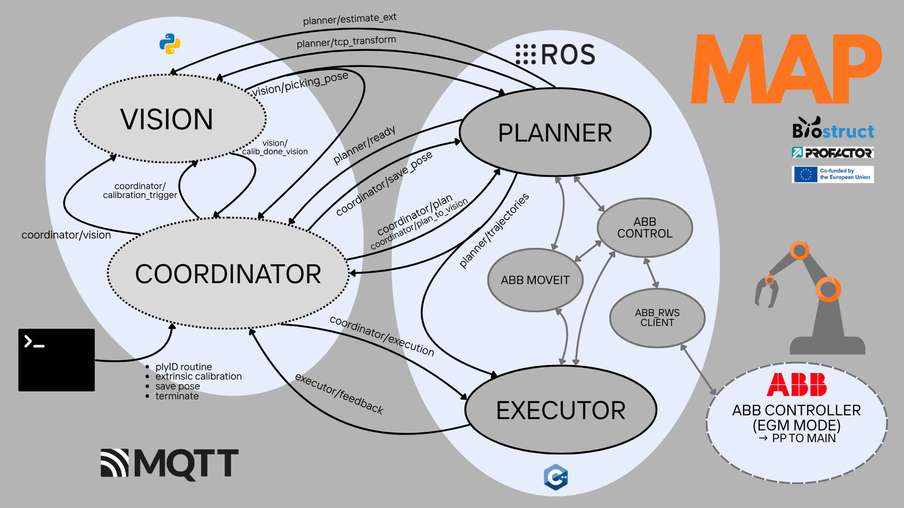

<table align="center">
  <tr>
    <td align="center"></td>
    <td align="center">
      <br>
      
    </td>
  </tr>
</table>

# BioStruct Vision-Robotics

**Integrated Vision-Robotic Software for Automated Draping of Bio-Fiber Composite Parts:
An Industrial Implementation within the BioStruct Project**

*Master's Thesis in Computer Engineering — Luca Grigolin, Università degli Studi di Padova (DEI), developed at PROFACTOR GmbH.*

This repository contains the full software stack described in the thesis: a vision-guided pick-and-drape cell in which an ABB IRB 6700-205/2.80 robot picks bio-fiber plies, verifies them with a camera and places them on the mould. Three independent modules talk to each other over MQTT, each one owning a single concern.



## Highlights

- **Modular, language-agnostic architecture** — Python vision and coordination nodes, C++ ROS 2 planning and execution nodes, all connected through an MQTT broker.
- **Real-time robot control** — ABB IRB 6700 driven through ROS 2 `ros2_control` + EGM, with RWS for controller management and MoveIt for path planning.
- **Vision pipeline** — Camera–TCP extrinsic (hand-eye) calibration, ply verification and 6D ply-pose estimation for picking, using a Genie Nano M2590 mono camera and AprilTags.
- **Single-command orchestration** — one launcher brings up the whole stack on real, virtual (RobotStudio) or fake hardware.
- **Two cell configurations** — a development cell (`biostruct_robotics_lab`) and the final AMURA draping cell with the ProPoint gripper (`biostruct_amura`).

## Repository structure

| Folder | Module | Content |
|---|---|---|
| [`coordinator_ws/coordinator_app`](coordinator_ws/coordinator_app/README.md) | **Coordinator** (Python) | Supervises the routine (ply ID routine, extrinsic calibration, save pose, terminate) and hosts the stack launcher. |
| [`vision_ws/vision_app`](vision_ws/vision_app/README.md) | **Vision** (Python) | Extrinsic calibration, ply verification and 6D pose estimation; calibration data. |
| [`abb_ws/src/profactor_ros2`](abb_ws/src/profactor_ros2/README.md) | **Planner / Executor** (ROS 2, C++) | Robot integration, path planning, trajectory execution, robot description, MoveIt config and pose memory. |

## Requirements

- Ubuntu 24.04 · ROS 2 Jazzy · Python 3.12
- Mosquitto MQTT broker (2.0.x)
- Teledyne Spinnaker SDK (camera acquisition via `harvesters`)
- ABB ROS 2 driver stack (`abb_ros2`, `abb_libegm`, `abb_librws`, `abb_egm_rws_managers`, `abb_ros2_msgs`) and the ROS 2 `mqtt_client`, cloned into `abb_ws/src`

## Installation (brief)

```bash
# Clone where the launcher expects it
git clone https://github.com/Luckycrucio/BioStructVisionRobotics.git ~/BioStruct_DrapeBot

# ROS 2 workspace (after adding the ABB driver and mqtt_client packages to abb_ws/src)
cd ~/BioStruct_DrapeBot/abb_ws
rosdep install --from-paths src -y --ignore-src
colcon build && source install/setup.bash

# Python environments
cd ~/BioStruct_DrapeBot/vision_ws/vision_app
python3 -m venv .vision_env && source .vision_env/bin/activate && pip install -r requirements.txt && deactivate

cd ~/BioStruct_DrapeBot/coordinator_ws/coordinator_app
python3 -m venv .coordinator_env && source .coordinator_env/bin/activate && pip install -r requirements.txt && deactivate
```

Camera SDK, intrinsic calibration (`cv_ext`) and AprilTag generation are covered in the [Vision README](vision_ws/vision_app/README.md).

## Launch

```bash
cd ~/BioStruct_DrapeBot/coordinator_ws/coordinator_app/launch

python3 launch_stack.py --robot-ip 192.168.125.1   # real robot
python3 launch_stack.py --robot-ip 192.168.125.20  # virtual controller
python3 launch_stack.py                            # fake hardware
```

Each component (RWS client, ABB control, MoveIt, Planner, Executor, Vision, Coordinator) opens in its own terminal; the routine is then driven from the Coordinator terminal. Module-specific notes (collision configs, pose memory, cell variants) are in the sub-READMEs.

## Citation

If you use this work, please cite the thesis:

```bibtex
@mastersthesis{grigolin2026biostruct,
  author = {Luca Grigolin},
  title  = {Integrated Vision-Robotic Software for Automated Draping of Bio-Fiber Composite Parts: An Industrial Implementation within the BioStruct Project},
  school = {Universit{\`a} degli Studi di Padova},
  year   = {2026},
  note   = {Master's Thesis in Computer Engineering, developed at PROFACTOR GmbH}
}
```

## Acknowledgements


The work presented in this thesis is related to the project “BioStruct” and has received funding from the European Union’s Horizon Europe research and innovation programme under grant agreement No 101136335. Views and opinions expressed are however those of the author(s) only and do not necessarily reflect those of the European Union. Neither the European Union nor the granting authority can be held responsible for them.
